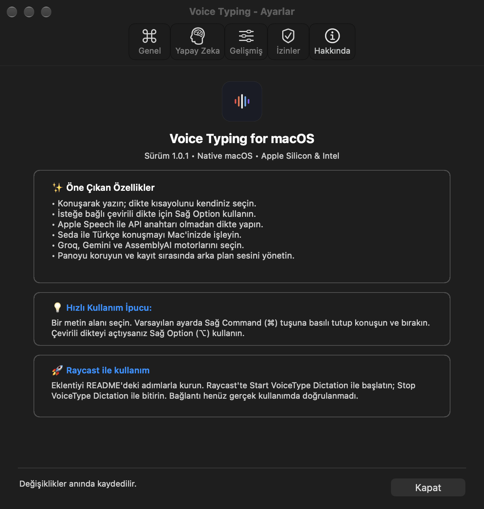
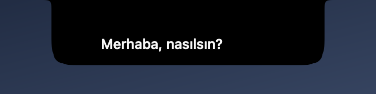

# VoiceType 🎙️

**Mac'inizde konuşarak yazın. İsterseniz konuşmanızı başka bir dile çevirin.**

VoiceType, macOS menü çubuğunda çalışan açık kaynaklı bir uygulamadır. Mesaj, e-posta veya belge yazarken konuşmanızı metne dönüştürür.



## Neler yapabilir?

- **Konuşarak yazın:** Bir metin alanı seçin, Sağ Command tuşuna basılı tutun ve konuşun.
- **Çevirerek yazın:** Çeviriyi açın ve Sağ Option ile konuşun. Metin seçtiğiniz dile çevrilir.
- **Motoru seçin:** Apple Speech, yerel Seda veya desteklenen bulut servislerini kullanın.
- **Raycast ile başlatın:** Dikteyi Raycast komutlarıyla başlatın veya durdurun.
- **Çalışmanıza devam edin:** VoiceType arka planda çalışır. Ayarları menü çubuğundan değiştirirsiniz.

## Ücretsiz kullanabilir miyim?

Evet. VoiceType ücretsiz ve açık kaynaklıdır. **Normal dikte için ücretli bir servise veya API anahtarına ihtiyacınız yoktur.**

- **Apple Speech:** macOS ile gelir ve varsayılan olarak seçilidir. Desteklenen cihaz ve dillerde yerel tanıma kullanılır. Diğer durumlarda Apple'ın konuşma tanıma davranışı geçerlidir.
- **Seda-v0.1:** Türkçe konuşmayı Mac'inizde işler. İlk kurulumda model indirilir; sonrasında dikte için bulut servisi ve API anahtarı gerekmez.
- **Groq ve Gemini:** İsteğe bağlı bulut servisleridir. Hesap ve API anahtarı gerektirir. Uygun ücretsiz kotalar hafif kullanım için yeterli olabilir; kota, model erişimi ve fiyatlar değişebilir.

Çevirili dikte şu anda Groq veya Gemini gerektirir. Kullanımınız ücretsiz kotayı aşarsa veya ücretli bir plan seçerseniz sağlayıcınız ücret uygulayabilir. Güncel koşulları [Groq](https://console.groq.com/docs/rate-limits) ve [Gemini](https://ai.google.dev/gemini-api/docs/rate-limits) üzerinden kontrol edin.

## Kurulum

**Gerekenler:** macOS 13 veya daha yeni bir sürüm ve mikrofon. Apple Silicon ve Intel Mac'ler desteklenir.

### Son sürümü indirin

1. [Sürümler sayfasını](https://github.com/omercom/voicetype-app/releases) açın.
2. En son sürümün `VoiceType-...-macOS.zip` dosyasını indirin.
3. Arşivi açın. `VoiceTyping.app` dosyasını Uygulamalar klasörüne taşıyıp açın.

> [!IMPORTANT]
> İndirilen uygulama Developer ID ile imzalanmadı ve Apple tarafından noterlenmedi. macOS Gatekeeper uygulamanın açılmasını engelleyebilir. Kaynaktan kurulum aşağıdadır.

İndirilen paket otomatik başlangıç kurmaz. İsterseniz macOS giriş öğelerine VoiceTyping'i ekleyebilirsiniz.

### Terminal ile kurun

[Xcode Komut Satırı Araçları](https://developer.apple.com/xcode/resources/) gerekir. Terminal'e şu tek komutu yapıştırın:

```bash
git clone --depth 1 --branch v1.0.1 https://github.com/omercom/voicetype-app.git && (cd voicetype-app && ./install.sh)
```

Komut kaynak kodunu indirir ve [kurulum betiğini](install.sh) çalıştırır. Uygulamayı derler, Uygulamalar klasörüne yerleştirir ve otomatik başlatmayı açar. `voicetype-app` klasörü zaten varsa komut mevcut dosyaları değiştirmez.

### Uygulama nerede?

VoiceType'ın simgesi ekranın **sağ üstündeki menü çubuğunda**, saat ve Wi-Fi simgelerinin bulunduğu alanda görünür.

Simgeye tıklayarak **Ayarlar**, ses tanıma motoru ve diğer seçeneklere ulaşabilirsiniz. Ayarlarınızı değiştirdiğinizde ayrıca kaydetmeniz gerekmez.

### İzinleri açın

İlk kullanımda macOS'un istediği izinleri onaylayın:

1. **Mikrofon:** Konuşmanızı kaydetmek için.
2. **Erişilebilirlik:** Kısayolu algılamak ve metni seçtiğiniz alana yazmak için.
3. **Konuşma Tanıma:** Yalnızca Apple Speech kullanırken.

İzinlerin durumunu VoiceType → **Ayarlar → İzinler** bölümünden kontrol edebilirsiniz.

## Nasıl kullanılır?

### Konuşarak yazın

1. Mesaj, e-posta, not veya başka bir metin alanına tıklayın.
2. **Sağ Command (⌘)** tuşuna basılı tutun ve konuşun.
3. Bitirdiğinizde tuşu bırakın. VoiceType metni seçtiğiniz alana yapıştırır.

Kayıt sırasında vazgeçmek için **Esc** tuşuna basın. Kısayolu ve diğer davranışları Ayarlar'dan değiştirebilirsiniz.

### Dikte göstergesi

| Notch View — MacBook çentiği | Kapsül — ekranın altı |
|:---:|:---:|
|  |  |

Görseller örnek metin ve temsili arka plan kullanır. **Ayarlar → Gelişmiş → Gösterge Stili** bölümünden görünümü seçebilirsiniz. Notch View, çentikli MacBook ekranlarında kullanılır; diğer ekranlarda kapsül görünür.

### Konuşmanızı çevirin

1. Menü çubuğundan **Ayarlar** penceresini açın.
2. **Sağ Option ile Çevir** seçeneğini açın ve hedef dili seçin.
3. Groq veya Gemini API anahtarınızı Ayarlar'a ekleyin.
4. Bir metin alanına tıklayın. **Sağ Option (⌥)** tuşuna basılı tutarak konuşun ve bitince bırakın.

Örneğin Türkçe konuşup İngilizce yazabilirsiniz. İngilizce, Almanca, İspanyolca ve Fransızca hedef diller arasındadır. **Sağ Command** normal dikte yapmaya devam eder.

VoiceType, uygun canlı tanıma sonuçlarında cümleleri konuşma sırasında arka planda çevirmeye başlayabilir. Sonucu tek seferde yapıştırır. Çeviri başarısız olursa özgün metni korur ve sizi uyarır.

### Raycast ile kullanın

Önce bir metin alanı seçin. Raycast'te **Start VoiceType Dictation** ile konuşmaya başlayın; **Stop VoiceType Dictation** ile bitirin. **Open VoiceType Settings**, ayarları açar.

Eklentiyi kendi Mac'inize kurmanız gerekir; henüz Raycast Store'da değildir. Raycast ve macOS otomasyon bağlantısı gerçek kullanımda henüz doğrulanmadı. [Raycast kurulum adımlarına](integrations/raycast/README.md) bakın.

### Türkçe dikteyi tamamen yerel çalıştırın

Seda-v0.1 için [uv](https://docs.astral.sh/uv/getting-started/installation/) ve kaynak kodu gerekir. Terminal ile kurduysanız `voicetype-app` klasörüne geçin ve şu komutu çalıştırın:

```bash
./setup-stt.sh
```

Kurulum bitene kadar Seda, sağlayıcı listesinde görünmez. Kurulumdan sonra menüyü yeniden açın ve **Ses Tanıma → Harfiyen · Seda-v0.1** seçeneğini seçin. Dili **Türkçe (`tr`)** olarak ayarlayın. İlk kurulum model dosyalarını indirir; sonraki dikte işlemleri Mac'inizde çalışır. Tek kayıt en fazla 10 dakika sürer.

Model lisansları ve ayrıntılar için [Seda kurulumuna](runtime/seda/README.md) bakın.

## Gizlilik

- **Apple Speech:** Desteklenen durumlarda konuşma cihazda işlenir. Diğer durumlarda Apple'ın konuşma tanıma koşulları geçerlidir.
- **Seda:** Kurulum tamamlandıktan sonra konuşma tanıma Mac'inizde yapılır.
- **Groq, Gemini ve AssemblyAI:** Bu servislerden biri ses tanıma için seçilirse kayıt o servise gönderilir.
- **Çeviri:** Metin Groq veya Gemini'ye gönderilir. Otomatik seçimde Groq başarısız olursa metin yapılandırılmış Gemini'ye de gönderilebilir. Ara cümleler konuşma sürerken gönderilebilir.
- **İzinler:** Erişilebilirlik izni, kısayollar ve metni hedef alana yazmak için kullanılır. API anahtarları kullanıcı hesabındaki yerel ayarlarda saklanır.

Özel içerikleri göndermeden önce seçtiğiniz sağlayıcının gizlilik ve ücret koşullarını kontrol edin. Ayrıntılı bilgi: [dikte ve çeviri kılavuzu](docs/VOICE_TYPING.md).

## Yardım

- **Simge görünmüyor:** Uygulamanın açık olduğunu ve menü çubuğunda yeterli yer bulunduğunu kontrol edin.
- **Kısayol çalışmıyor:** Mikrofon ve Erişilebilirlik izinlerini kontrol edin. Apple Speech için Konuşma Tanıma iznini de açın.
- **Metin yazılmıyor:** Önce düzenlenebilir bir metin alanı seçin. Bazı güvenli alanlar veya uygulamalar otomatik yapıştırmayı sınırlayabilir.
- **Çeviri çalışmıyor:** Çevirinin açık olduğunu, API anahtarını, internet bağlantısını ve sağlayıcı kotasını kontrol edin.

Daha fazla kurulum, gizlilik ve sorun giderme bilgisi için [VoiceType kılavuzuna](docs/VOICE_TYPING.md) bakın.

## Geliştiriciler

```bash
swift test
```

Canlı API ve mikrofon testleri varsayılan olarak kapalıdır. Bunları etkinleştirme koşulları [test kılavuzunda](docs/VOICE_TYPING.md) açıklanır.

## Lisans ve teşekkür

VoiceType için MIT lisansı belirtilmiştir; depoda henüz ayrı bir lisans dosyası yoktur. Harfiyen ve Seda-v0.1'in kendi lisansları geçerlidir. Bazı tasarım yaklaşımları için [AlwaysWhisper](https://github.com/kzkhykw/AlwaysWhisper) projesinden yararlanılmıştır.
