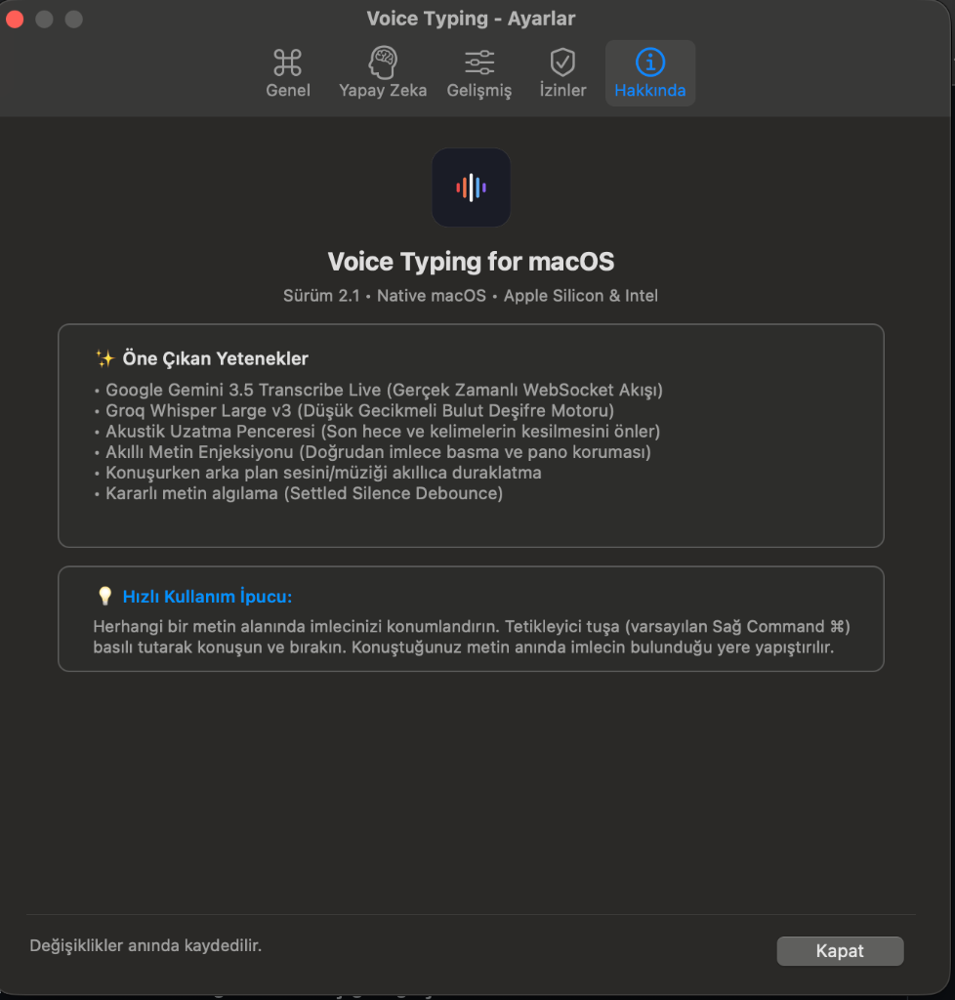
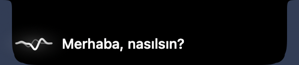

<div align="center">

# 🎙️ VoiceType

**Mac'inizde klavyeden hızlı konuşarak yazın — isterseniz anında başka bir dile çevirerek.**

[](https://github.com/omercom/voicetype-app/releases/latest)
[](https://github.com/omercom/voicetype-app/releases/latest)
[](Package.swift)
[](#motorlar-ve-%C3%BCcretsiz-kullan%C4%B1m)

Bir yazı alanına tıklayın · **Sağ Command (`⌘`)** tuşuna basılı tutup konuşun · Bıraktığınız anda temiz metin yerine yapışsın.<br>
Başka bir dilde mi yazmanız gerekiyor? **Sağ Option (`⌥`)** ile Türkçe konuşun; Slack, Mail, Cursor veya tarayıcıya doğrudan İngilizce, Almanca, Fransızca, İspanyolca ya da Hollandaca düşsün.

<br>



<p>
  <a href="https://github.com/omercom/voicetype-app/releases/latest"><strong>⬇️ Son Sürümü İndir (.zip)</strong></a> ·
  <a href="#kurulum"><strong>⚡ Tek Komutla Kur</strong></a> ·
  <a href="#neden-voicetype"><strong>✨ Özellikler</strong></a> ·
  <a href="docs/VOICE_TYPING.md"><strong>📖 Teknik Kılavuz</strong></a>
</p>

</div>

---

## ✨ Ekranınızda Nasıl Görünür?

VoiceType arka planda sessizce menü çubuğunda bekler; yalnızca konuştuğunuz anda **Metal GPU hızlandırmalı 60 Hz fosfor nokta matrisi (`Hex Dot Scope`)** ile canlanır:

| Dynamic Island — MacBook Çentiği | Kapsül & Hex Dot Scope — Ekranın Altı |
|:---:|:---:|
|  |  |
| Üst sekmeleri kapatmayan iki aşamalı çentik adası ve canlı metin/çeviri akışı | Tüm ekranlarda çalışan kompakt kapsül veya yazısız **Hex Minimal** görünümü |

> **Ayarlar → Gelişmiş → Gösterge Stili** altından **Kapsül**, **Dynamic Island** veya **Hex Minimal** modunu ve **Akış / Nabız / Tarama** efektini anında önizleyerek seçebilirsiniz.

---

## 🚀 Neden VoiceType?

- **🧠 Tamamen Çevrimdışı & Sıfır Maliyet (Apple ANE):** Abonelik yok, zorunlu hesap yok. macOS 26+ üzerinde Apple Neural Engine (`SpeechAnalyzer` + `TranslationSession`) ile hem dikte hem de çeviri **internetsiz, süre sınırsız ve 0 TL** maliyetle Mac'inizde çalışır.
- **🌐 Tek Tuşla Canlı Çevirerek Yazma (`Sağ ⌥`):** Türkçe düşünüp konuşun; konuştuğunuz cümleler HUD'da anlık çeviri önizlemesiyle (`🌐`) işlensin ve hedef uygulamaya seçtiğiniz dilde tek seferde yapışsın.
- **⚡ İstediğiniz Yapay Zeka Motorunu Seçin:** Cihaz içi **Apple ANE / Apple Speech** ve yerel Türkçe **Harfiyen · Seda-v0.2** motorlarının yanında, dilediğiniz an **Google Gemini Live**, **Groq Whisper (`whisper-large-v3`)** veya **AssemblyAI (`Universal-3.5 Pro`)** bulut hızına geçin.
- **🎯 Hedef Uygulamayı Tanıyan Akıllı Biçimlendirme:**
  - **Terminal & Kod Editörleri (Cursor, VS Code, Ghostty, iTerm):** Komut satırı ve kod dostu biçimlendirme.
  - **Sohbet (Slack, WhatsApp, Discord, Telegram):** Doğal ve akıcı mesajlaşma üslubu.
  - **E-posta & Belgeler (Mail, Notion, Docs):** Tam noktalama ve resmi imla kuralları.
- **⏎ El Değmeden Otomatik Gönderim (Auto-Submit):** ChatGPT, Claude, Cursor, Slack veya Terminal'de konuşmanız biter bitmez metni yapıştırıp `Enter`, `⌘Enter`, `⇧Enter` veya `Tab` tuşuna sizin yerinize basabilir.
- **🔉 Siri Kalitesinde Akıllı Müzik Kısma (CoreAudio Ducking):** Dikte başladığında arka plandaki müziği sistem ses çubuğunuzu bozmadan `-13.5 dB` yumuşak geçişle kısar (veya duraklatır); tuşu bıraktığınızda eski seviyesine döndürür.
- **🧹 Tertemiz Çıktı & Fısıltı Desteği:** *"ııı, şey, yani"* gibi dolgu kelimeleri ve sessizlikte oluşabilen altyazı halüsinasyonlarını otomatik temizler; **Mic Boost** ile gece kısık sesle veya fısıltıyla konuşurken bile net kayıt alır.
- **🧩 Sesli Kısayollar & Özel Sözlük:** `"kısayol mail = ad@sirket.com"` gibi tetikleyiciler tanımlayın; teknik terimlerinizi, marka ve kişi adlarını özel sözlüğe ekleyerek her seferinde doğru yazdırın.
- **🛡️ Kaya Gibi Güvenilir Yapıştırma:** Web, Electron ve IDE alanlarında yapıştırmayı doğrular, önceki panonuzu korur, `⌥⇧V` ile son dikteyi anında yeniden yapıştırır ve ağ kesilse bile kaydı kaybetmeden menüden tek tıkla yeniden deşifre etmenizi sağlar.

---

## 🎛️ Motorlar ve Ücretsiz Kullanım

VoiceType **ücretsiz ve açık kaynaklıdır**. Normal dikte ve (macOS 26+ üzerinde) çevirili dikte için hiçbir ücretli servise veya API anahtarına ihtiyacınız yoktur:

| Motor | Görev | Nerede Çalışır? | API Anahtarı | Öne Çıkan Gücü |
| :--- | :--- | :---: | :---: | :--- |
| **Apple ANE (`SpeechAnalyzer`)** | Dikte | 💻 Cihaz içi (macOS 26+) | Gerekmez | Çevrimdışı, süre sınırsız, 10+ dil paketi tek tıkla indirilir |
| **Apple Speech** | Dikte | 💻 Yerel / macOS (13+) | Gerekmez | Kutudan çıktığı anda hazır varsayılan motor |
| **Apple ANE (`Translation`)** | Çeviri (`Sağ ⌥`) | 💻 Cihaz içi (macOS 26+) | Gerekmez | 0 TL çevrimdışı çeviri + konuşurken canlı HUD önizlemesi |
| **Harfiyen · Seda-v0.2** | Türkçe Dikte | 💻 Cihaz içi | Gerekmez | Türkçe için özelleştirilmiş tamamen yerel model |
| **Google Gemini Live** | Dikte & Çeviri | ☁️ Bulut | İsteğe bağlı | WebSocket ile gerçek zamanlı akış ve özel sistem istemi |
| **Groq Whisper** | Dikte & Çeviri | ☁️ Bulut | İsteğe bağlı | `whisper-large-v3` ile milisaniyeler içinde toplu deşifre |
| **AssemblyAI Dictation** | Dikte | ☁️ Bulut | İsteğe bağlı | `Universal-3.5 Pro` ile öz-düzeltme ve dolgu temizliği |

> Bulut servisleri isteğe bağlıdır; ücretsiz kotalar günlük hafif kullanım için çoğu zaman yeterlidir. Güncel kota ve fiyat koşullarını [Groq](https://console.groq.com/docs/rate-limits), [Gemini](https://ai.google.dev/gemini-api/docs/rate-limits) ve AssemblyAI sayfalarından kontrol edebilirsiniz.

---

## 📦 Kurulum

**Gereksinimler:** macOS 13 Ventura veya daha yeni bir sürüm (Apple ANE çevrimdışı motorları için macOS 26+) · Apple Silicon (`M1–M4+`) veya Intel Mac · Mikrofon.

### Seçenek 1 — Hazır Paketi İndirin (En Hızlı)

1. [**Son sürüm sayfasından**](https://github.com/omercom/voicetype-app/releases/latest) `VoiceType-...-macOS.zip` dosyasını indirin.
2. Arşivi açın ve `VoiceTyping.app` uygulamasını **Uygulamalar (`Applications`)** klasörüne sürükleyin.
3. İlk açılışta uygulamaya **sağ tıklayıp Aç** deyin.

> [!NOTE]
> Hazır `.zip` paketi Apple Developer ID ile noterlenmediği için macOS Gatekeeper ilk açılışta onay isteyebilir. Sağ tıklayıp **Aç** diyebilir veya Terminal'de `xattr -dr com.apple.quarantine /Applications/VoiceTyping.app` komutunu çalıştırabilirsiniz. Mac açılışında otomatik başlamasını isterseniz **Ayarlar → Genel → Mac açıldığında otomatik başlat** kutusunu işaretlemeniz yeterlidir.

### Seçenek 2 — Terminal ile Kaynaktan Kurun (Otomatik Başlatma Dahil)

[Xcode Komut Satırı Araçları](https://developer.apple.com/xcode/resources/) kuruluysa şu tek satır uygulamayı derler, `/Applications` klasörüne kurar ve otomatik başlatmayı etkinleştirir:

```bash
git clone --depth 1 https://github.com/omercom/voicetype-app.git && (cd voicetype-app && ./install.sh)
```

### İlk İzinler (30 Saniye)

Uygulama açıldığında ekranın sağ üstündeki **menü çubuğunda (`🎙️`)** yerini alır. **Ayarlar → İzinler** sekmesinden durum rozetlerini (`🟢`) görebilir ve tek tıkla ilgili macOS ayarına gidebilirsiniz:

1. **Mikrofon:** Konuşmanızı yakalamak için.
2. **Erişilebilirlik:** Bas-konuş kısayolunu algılamak ve metni aktif yazı alanına yapıştırmak için.
3. **Konuşma Tanıma:** Yalnızca Apple'ın yerleşik konuşma motorunu kullanırken gerekir.

---

## ⌨️ Nasıl Kullanılır?

### Günlük Kısayollar

| Kısayol / Tetikleyici | Ne Yapar? |
| :--- | :--- |
| **Sağ Command (`⌘`)** *(Basılı tut)* | Konuşmanızı seçili dilde metne çevirir ve bıraktığınızda imlecin olduğu yere yapıştırır |
| **Sağ Option (`⌥`)** *(Basılı tut)* | Konuşmanızı hedef dile **çevirir** (ör. Türkçe → İngilizce) ve doğrudan çevirisini yapıştırır |
| **Esc** | Aktif kaydı veya bekleyen çeviriyi hiçbir şey yazdırmadan anında iptal eder |
| **Option + Shift + V (`⌥⇧V`)** | Son dikte edilen metni tek tuşla yeniden yapıştırır |
| **Ek Tetikleyiciler** *(İsteğe bağlı)* | **Akıllı Hibrit** (dokun: aç-kapa / basılı tut: konuş), **Caps Lock** eller-serbest, **Fare Yan Tuşları (Mouse 4/5)** ve **MacBook Dikte/Mikrofon tuşu** |

### Konuşmanızı Anında Çevirin (`Sağ ⌥`)

1. Menü çubuğundaki VoiceType simgesinden **Ayarlar → Yapay Zeka** sekmesini açın.
2. **Çeviri (Sağ ⌥)** bölümünde **Sağ ⌥ Çeviri Açık** anahtarını etkinleştirin ve hedef dili seçin (*İngilizce, Almanca, İspanyolca, Fransızca, Hollandaca*).
3. Motor olarak **Apple Çevrimdışı** seçiliyse (macOS 26+) **Paketi İndir** düğmesiyle dil paketini bir kez indirin — ya da **Google Gemini / Groq** bulut motorlarından birini seçin.
4. Herhangi bir uygulamada **Sağ Option (`⌥`)** tuşuna basılı tutarak Türkçe konuşun; bıraktığınızda çevrilmiş metin yapıştırılır. **Sağ Command (`⌘`)** her zaman normal dikte yapmaya devam eder.

### Yerel Türkçe Seda-v0.2 Motoru (İsteğe Bağlı)

macOS 13–15 sistemlerde de Türkçe konuşmayı tamamen yerel bir modelle işlemek isterseniz [uv](https://docs.astral.sh/uv/getting-started/installation/) kurduktan sonra kaynak klasöründe şu komutu çalıştırın:

```bash
./setup-stt.sh
```

Kurulum tamamlandığında menüden **Ses Tanıma → Harfiyen · Seda-v0.2** seçeneği aktif olur. Ayrıntılar ve model lisansları için [Seda kurulum rehberine](runtime/seda/README.md) göz atabilirsiniz.

### Raycast Entegrasyonu

Raycast üzerinden **Start VoiceType Dictation**, **Stop VoiceType Dictation** ve **Open VoiceType Settings** komutlarıyla dikteyi klavye akışınıza bağlayabilirsiniz. Kurulum adımları için [Raycast rehberine](integrations/raycast/README.md) bakın.

---

## 🔒 Gizlilik

- **Cihaz İçi Modlar (Apple ANE & Seda-v0.2):** Çevrimdışı dil paketleri kurulduğunda sesiniz ve çeviriniz Mac'inizden dışarı çıkmaz. (Desteklenmeyen sistem/dil durumlarında Apple'ın standart konuşma tanıma koşulları geçerlidir.)
- **Bulut Modları (Gemini, Groq, AssemblyAI):** Yalnızca siz bu sağlayıcılardan birini seçtiğinizde ses veya çevrilecek metin ilgili servise gönderilir.
- **Şeffaf İzin Kapsamı:** Erişilebilirlik izni yalnızca kısayol tuşunu dinlemek, aktif yazı alanını doğrulamak ve `⌘V` ile metni teslim etmek için kullanılır; normal klavye yazımınız kaydedilmez. API anahtarlarınız yalnızca kendi kullanıcı hesabınızdaki yerel yapılandırmada saklanır.

Daha derin teknik mimari ve gizlilik ayrıntıları için [VoiceType Teknik Kılavuzuna](docs/VOICE_TYPING.md) bakın.

---

## 🛠️ Sorun Giderme

- **Menü çubuğunda simge görünmüyor:** Uygulamanın açık olduğundan ve MacBook çentiğinin sağında menü öğeleri için yer kaldığından emin olun.
- **Kısayol tepki vermiyor:** **Ayarlar → İzinler** sekmesinden **Mikrofon** ve **Erişilebilirlik** rozetlerinin yeşil (`🟢`) olduğunu doğrulayın.
- **Metin hedef alana yapışmıyor:** Yazmaya başlamadan önce düzenlenebilir bir metin kutusuna tıklayın. Yapıştırma doğrulanamazsa metin kaybolmaz; panonuzda hazır bekler veya menüden yeniden yapıştırılabilir.
- **Çeviri çalışmıyor:** **Yapay Zeka** sekmesindeki **Test Et** düğmesiyle çevrimdışı dil paketinin kurulu olduğunu veya bulut API anahtarınızın aktif olduğunu tek tıkla kontrol edin.

---

## 👨‍💻 Geliştiriciler

```bash
# Release binary ve VoiceTyping.app paketini derle
./scripts/build.sh

# Universal (arm64 + x86_64) dağıtım paketini üret
./scripts/package-release.sh

# Birim testlerini çalıştır (Xcode kurulu ortamda)
swift test
```

Canlı API ve mikrofon testleri varsayılan olarak kapalıdır; etkinleştirme değişkenleri [teknik kılavuzda](docs/VOICE_TYPING.md) açıklanmıştır.

## 📄 Lisans ve Teşekkür

VoiceType için MIT lisansı belirtilmiştir; depoda henüz ayrı bir lisans dosyası yoktur. Harfiyen ve Seda-v0.2 modellerinin kendi lisans koşulları geçerlidir. Bazı arayüz ve etkileşim yaklaşımlarında [AlwaysWhisper](https://github.com/kzkhykw/AlwaysWhisper) ve [Hex](https://github.com/kitlangton/Hex) projelerinden ilham alınmıştır.
